# Beh3m0th

Beh3m0th (`beh3m0th` v0.1.0) is a Python 3.12+ autonomous research and code-engineering platform packaged as a single codebase under `src/beh3m0th/`. Given an engineering objective—such as *"find why authentication retries fail, propose a fix, patch it, and verify it"*—a typed supervisor routes work across `Researcher`, `Coder`, and `Reviewer` agents while enforcing token budgets on model inputs, grounding answers in verified chunk IDs or abstaining, confining tool execution to a workspace via RBAC, persisting cross-session memory, and grading trajectories against golden workflows. The system is designed for $0 local prototyping on embedded SQLite and Qdrant storage without LangChain, LlamaIndex, CrewAI, AutoGen, or the official MCP SDK; `langgraph` is imported exclusively inside `src/beh3m0th/agents/graph.py`.

| Module Path | Responsibility |
| :--- | :--- |
| `src/beh3m0th/context_engine/` | Counts tokens (`tiktoken` or offline estimation), allocates priority-based input budgets with largest-remainder rounding, water-fills unused memory budget into retrieval, and trims overflow. |
| `src/beh3m0th/retrieval/hybrid/` | Indexes Markdown (header-aware) and Python (stdlib `ast`) chunks into code-aware BM25 and local Qdrant vectors, fuses ranks via RRF, and reranks with FastEmbed ONNX cross-encoders. |
| `src/beh3m0th/retrieval/graphrag/` | Extracts zero-token Python AST entities/edges (`DEFINES`, `IMPORTS`, `INHERITS`, `CALLS`) and prose relations, clusters Leiden communities, and executes bounded multi-hop local and global queries. |
| `src/beh3m0th/retrieval/agentic_rag/` | Runs a self-correcting loop (`max_steps=3`) that rewrites queries, drops low-relevance hits (`tau_rel=0.60`), enforces citation groundedness (`tau_ground=0.80`), and abstains below `tau_abstain=0.55`. |
| `src/beh3m0th/mcp_server/` | Implements a hand-built JSON-RPC 2.0 (`2024-11-05`) tool server over in-process, `stdio`, and FastAPI SSE transports with workspace confinement, RBAC scopes, and sandboxed execution. |
| `src/beh3m0th/memory/` | Provides TTL working scratchpads, cosine-ranked SQLite episodic memory with recency/importance decay, deduplicated SQLite semantic facts, and deterministic or LLM-backed consolidation. |
| `src/beh3m0th/agents/` | Orchestrates typed `SupervisorAgent`, `ResearcherAgent`, `CoderAgent`, and `ReviewerAgent` nodes over `WorkflowState` with deterministic test checks, weighted consensus ballots, and conflict arbitration. |
| `src/beh3m0th/evaluation/` | Emits structured `TrajectoryStep` records (JSONL, SQLite, listeners) and grades runs offline with deterministic metrics or live with context-assembled LLM judge rubrics against golden baselines. |

---

## Architecture

1. **State initialization:** A Typer CLI command, FastAPI endpoint, or Streamlit page creates a strict `WorkflowState` (Pydantic v2, `extra="forbid"`) containing `run_id`, `session_id`, `project_id`, and `objective`.
2. **Supervisor state graph:** `SupervisorOrchestrator` compiles a LangGraph `StateGraph` (`START -> supervisor`, conditionally routing to `researcher`, `coder`, or `reviewer`, then returning to `supervisor`) with a recursion limit of `30` until `status` becomes `COMPLETED`, `ABSTAINED`, or `FAILED`.
3. **Execution & conflict arbitration:** Under the default lifecycle (`PLANNING -> RESEARCHING -> CODING -> REVIEWING`), the supervisor produces a three-step plan, the researcher gathers cited evidence, the coder proposes a patch and runs sandboxed tests, and the reviewer votes. When the review panel splits, `status` moves to `RESOLVING_CONFLICT` and resolves via `ACCEPT_CODER`, `ENFORCE_REVIEWER`, `REQUEST_NEW_RESEARCH`, or `ESCALATE_ABSTAIN`.
4. **Offline defaults & live injection:** Default CLI, FastAPI, and Streamlit execution paths run offline using scripted research and deterministic ballots without calling external LLM providers. Injecting a `TextCompleter` routes live model calls through `ContextAssembler`.
5. **Tool & trajectory boundary:** Agents access workspace tools through `MCPClient` (defaulting to `InProcessTransport`, with `stdio` and FastAPI HTTP/SSE `AsgiTransport` available), while `TrajectoryTracer` logs every `TrajectoryStep` for evaluation against golden workflows.

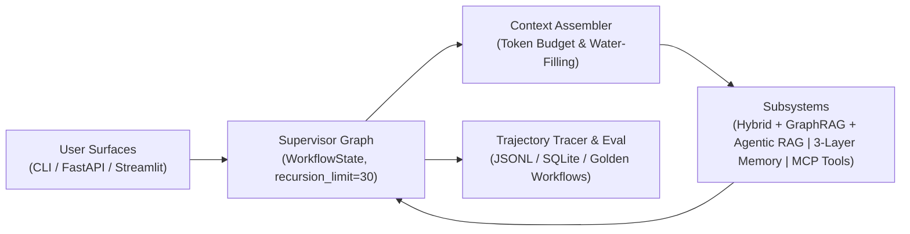

---

## Screenshots

Offline Streamlit demos. Each page runs on this machine with sample data.

### Phase list

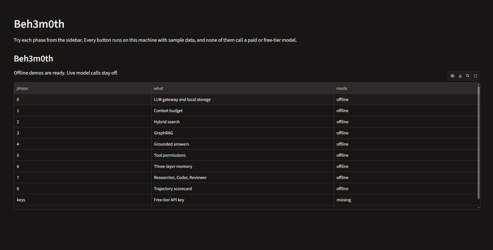

### Context budget

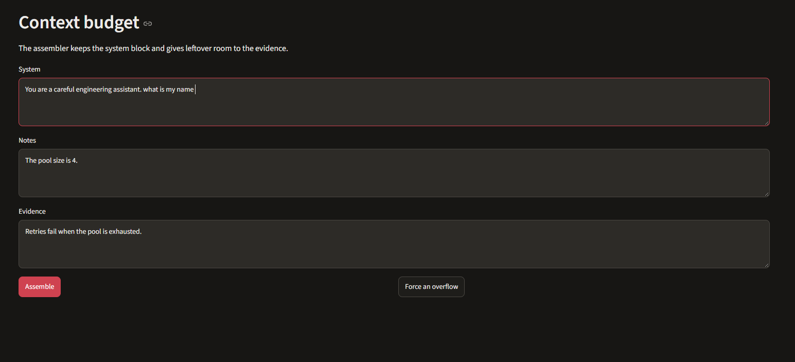

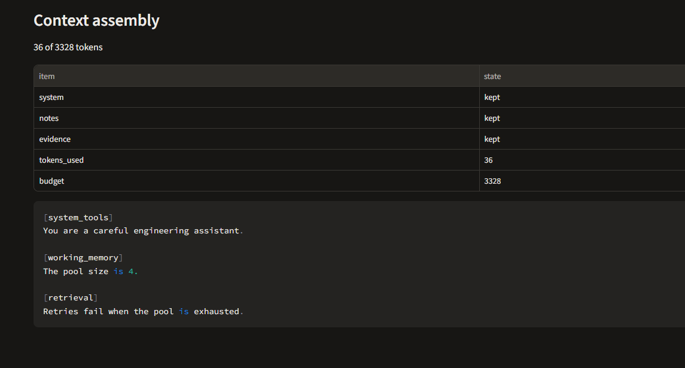

### Hybrid search

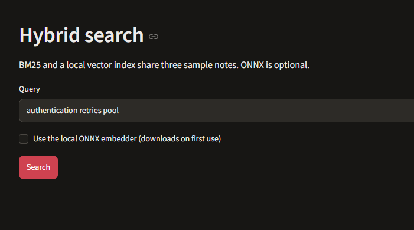

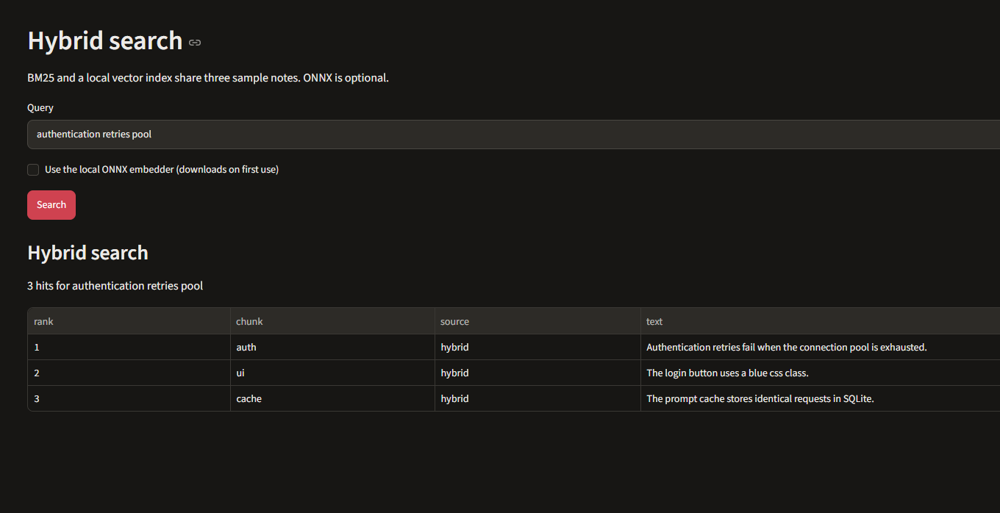

### GraphRAG

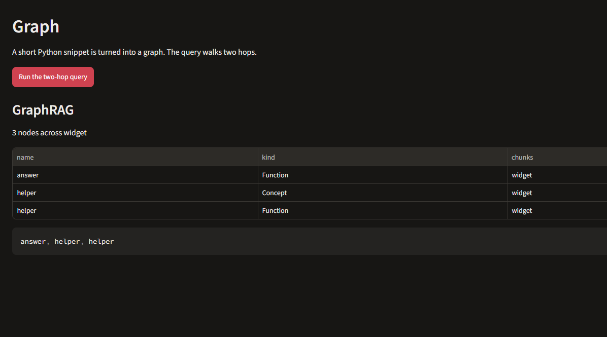

### Grounded answers

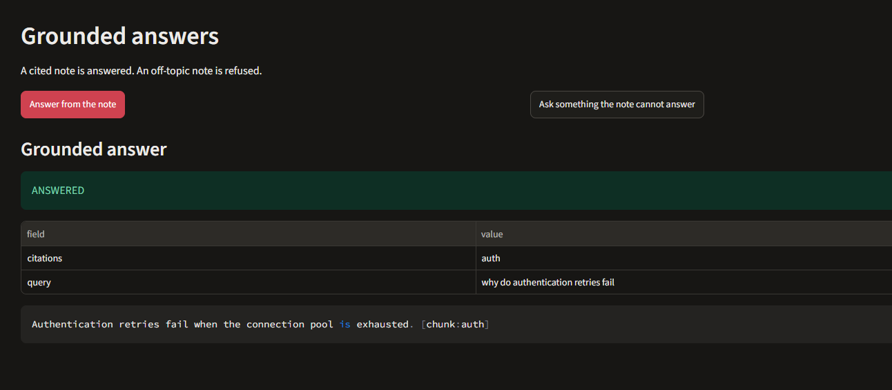

### Tool permissions

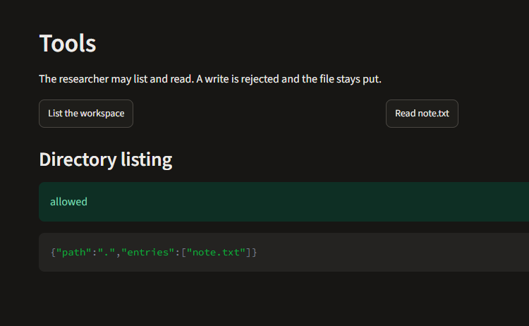

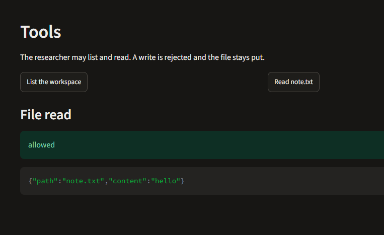

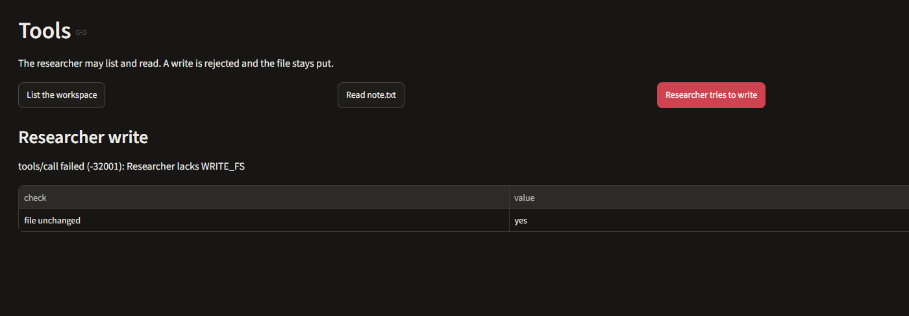

### Three-layer memory

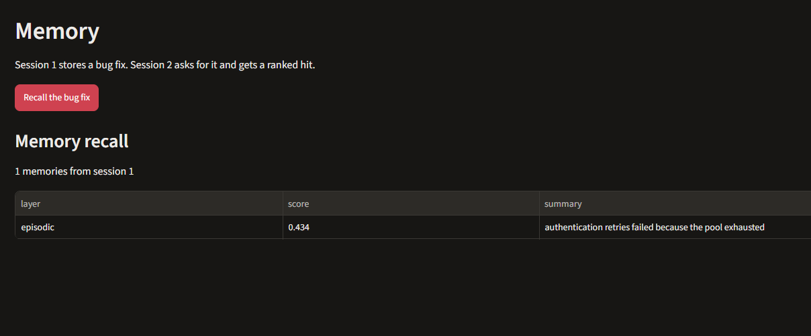

### Agents

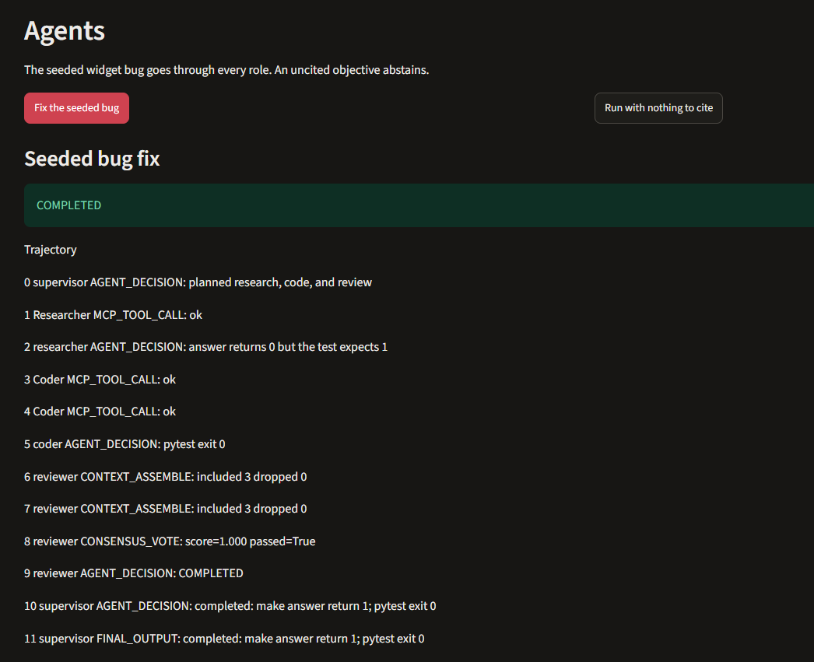

### Trajectory scorecard

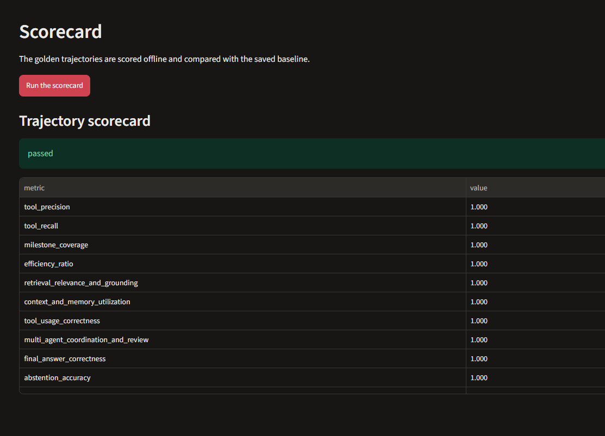
